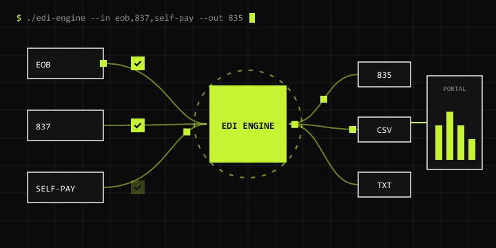

<p align="center"></p>

# Sachu S — Portfolio

Personal site of **Sachu S**, Technical Lead & Software Engineer building HIPAA-compliant healthcare data platforms (EDI 835/837, EOB processing) with Python, Django and FastAPI.



**Live:** [sachusudevan.github.io/portfolio](https://sachusudevan.github.io/portfolio/)

## Design — "Neo Terminal"

- Near-black canvas `#0B0B0B`, a single lime accent `#C6F432`, sharp edges everywhere.
- **Syne** for uppercase display type, **JetBrains Mono** for labels and UI, **Geist** for body copy.
- Terminal motifs throughout: boot loader, `$ whoami` prompt, `README.md` about panel, `git log` experience, `ls -la` projects, `contact.yml`.
- Photography shown monochrome with lime corner brackets, colour on hover.

## Motion

- Boot loader that types its startup log and splits open (once per session).
- Headlines rise line by line and their highlight word decodes (GSAP SplitText + ScrambleText).
- **Signature pipeline**: a pinned, scroll-scrubbed SVG of EOB/837/self-pay files flowing through EDI ENGINE into 835/CSV/TXT and Client Portal, with a terminal log that types each step.
- Tape marquee driven by scroll velocity, image wipes, parallax, count-up stats, a `git log` graph that draws as you scroll, and a horizontal photo strip.
- Filterable project list with animated line-art covers and a cursor-following preview, a block cursor and magnetic buttons.
- Smooth scrolling with Lenis. Everything respects `prefers-reduced-motion` (or add `?motion=off` to the URL).

## Structure

```
index.html            # the whole page (content + inline SVG)
css/tokens.css        # colours, fonts, type scale
css/base.css          # reset, chrome (nav, menu, loader, cursor, buttons, terminal panes)
css/sections.css      # hero → footer layouts and SVG animations
js/lib.js             # pure helpers shared with the tests
js/main.js            # boot, smooth scroll, nav, menu, loader
js/motion.js          # generic scroll/entrance animation
js/pipeline.js        # the signature pipeline timeline
js/work.js            # project filters, rows, hover preview
js/cursor.js          # custom cursor + magnetic elements
js/contact.js         # mailto form, copy email, live IST clock
assets/img/           # optimised photos (WebP + JPEG)
assets/svg/           # logo.svg and pipeline.svg (self-animating)
assets/pipeline.gif   # generated animation for this README
assets/og-image.png   # generated social share card
tools/                # scripts that generate the images/GIF/share card
tests/                # node:test suites
```

No build step: the site is plain HTML, CSS and JavaScript, with GSAP and Lenis loaded from a CDN. `index.html` also works when opened straight from disk.

## Develop

```bash
npm install        # dev tools only (tests, image + GIF generation, local server)
npm run serve      # http://localhost:5173
npm test           # structure, content, helper and media tests
npm run images     # re-optimise photos into assets/img
npm run gif        # regenerate assets/pipeline.gif
npm run og         # regenerate assets/og-image.png
```

## Deploy

GitHub Pages → **Settings › Pages** → deploy from the `main` branch, root folder.

## Accessibility

Semantic landmarks, a skip link, visible focus rings, keyboard-operable menu, filters and project rows, and real text behind every scramble/typing effect. Content stays fully visible if the animation scripts fail to load.

## Author

**Sachu S** — [LinkedIn](https://linkedin.com/in/sachu-s-705813179) · [GitHub](https://github.com/sachusudevan) · sachusudeve8690@gmail.com
